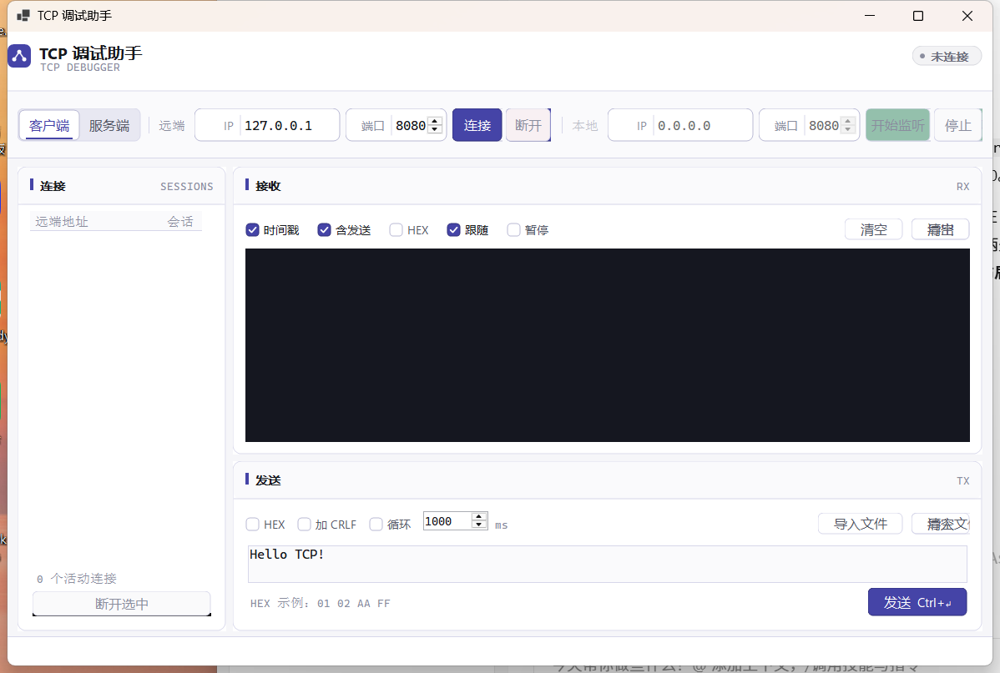

# TCP 调试助手

基于 C# / .NET 6 WinForms 的桌面 TCP 调试工具，可做 TCP 客户端或服务端，用于设备联调、协议收发测试。



## 快速开始

### 方式一：下载可执行文件（推荐，免编译）

到 [Releases](../../releases) 页面下载最新的 `TcpDebugger.exe`，双击运行。

前提：机器上装有 [.NET 6 Desktop Runtime](https://dotnet.microsoft.com/download/dotnet/6.0)（Windows 10/11 通常已自带）。

### 方式二：从源码编译

需要 .NET 6 SDK 或更高版本。

```bash
git clone https://github.com/HH200606/tcp-debugger.git
cd tcp-debugger
dotnet build -c Release
```

产物在 `bin/Release/net6.0-windows/TcpDebugger.exe`。

## 主要功能

| 功能 | 说明 |
|---|---|
| 两种模式 | 「TCP 客户端」主动连接远端；「TCP 服务端」本机监听、接受多个客户端 |
| 多连接管理 | 左侧列表显示所有活动连接（含本地/远端地址），服务端模式可多选后「断开选中」 |
| 文本收发 | 默认 UTF-8 文本收发，接收区高亮区分 `← RX` / `→ TX` |
| HEX 收发 | 勾选「HEX显示」/「HEX发送」切换；支持 `01 02 AA FF` 与 `0102AAFF` 两种写法 |
| 时间戳 | 每行可显示精确到毫秒的本地时间，便于对齐设备日志 |
| 自动发送 | 按设定间隔（默认 1000ms）循环发送当前内容，用于压测/心跳模拟 |
| 打开文件 | 从文件载入内容到发送区，HEX 模式下自动转成十六进制文本 |
| 保存日志 | 把全部收发记录导出为 `.log` 文本 |
| 流量统计 | 状态栏实时显示累计发送/接收字节数与连接数 |
| 界面保护 | 「暂停」停止刷新显示但后台继续收数；自动滚动仅在视口贴底时生效，向上翻看历史不会被打断 |

## 快捷键

- `Ctrl + Enter`：发送

## 典型用法

**连接一个 TCP 服务（客户端模式）**
1. 选「TCP 客户端」
2. 填远端IP / 端口（如 `127.0.0.1` / `8080`），点「连接」
3. 在发送区输入内容，点「发送」或按 `Ctrl + Enter`

**模拟一个 TCP 服务端（设备接入测试）**
1. 选「TCP 服务端」
2. 选本地IP（`0.0.0.0` 表示监听全部网卡），填监听端口，点「开始监听」
3. 设备连上来后，左侧「连接列表」会出现对应条目
4. 选中某条连接可单独发送；不选则默认发给全部连接

**发送二进制指令**
- 勾选「HEX发送」，输入 `A5 5A 01 00 FF` 后发送

## 工程结构

```
TcpDebugger/
├── TcpDebugger.csproj      项目文件（net6.0-windows / WinForms）
├── Program.cs              入口，含全局异常记录与 --selftest 分发
├── Tokens.cs               设计令牌：配色 / 字体 / 间距 / DPI 换算
├── Controls.cs             自绘控件：FlatButton、FlatCheckBox、StatusPill、
│                           SegmentedControl、LabeledInput、Card
├── MainForm.Ui.cs          界面层（partial）：布局、绘制、OnLoad 尺寸
├── MainForm.Logic.cs       业务层（partial）：连接 / 监听 / 收发 / 日志
├── TcpSession.cs           单条连接的收发封装（异步读 + 发送队列）
└── SelfTest.cs             内置自测（--selftest）
```

界面与业务拆成两个 partial 类文件，改样式只动 `MainForm.Ui.cs` + `Tokens.cs`，
不动收发逻辑。

## 设计系统

界面基于 `ui-ux-pro-max` 生成的方案：

| 维度 | 取值 |
|---|---|
| 产品类型 | Developer Tool（开发者工具） |
| 视觉风格 | Industrial / Utility —— 细边框、紧凑间距、等宽字体点缀 |
| 配色 | #97 Calm Complementary，主色 `#4544A7`，强调色 `#3533CC` |
| 正文字体 | Geist 系（缺字时自动回落到系统 UI 字体） |
| 正文对比度 | 16.46:1（WCAG AAA） |

要点：
- 所有颜色/字号/间距集中在 `Tokens.cs`，不散落在各处
- 按钮、复选框、分段控件、状态胶囊均为自绘，圆角 6dp、悬停/按下/禁用三态
- 接收区使用深色终端配色（`#151720` 底），RX 用薄荷绿、TX 用琥珀色区分方向
- 卡片式分区（连接 / 接收 / 发送），标题带主色竖条与等宽字体英文注记
- DPI 感知：`PerMonitorV2`，所有尺寸经 `Tokens.Dp()` 换算，125%/150% 缩放下不错位
- 工具栏采用手动定位布局，规避 WinForms 在 `Dock=Fill` + `Padding` 组合下
  的列宽归零与控件重叠问题

## 重新编译

```bash
cd TcpDebugger
dotnet build -c Release
```

> 若 exe 正在运行，需先关闭（文件被占用会导致 MSB3021 复制失败）。

## 自测

验证核心收发链路（客户端回显、HEX 解析、服务端多客户端群发），结果写入
`bin/Release/net6.0-windows/selftest.txt`：

```bash
TcpDebugger.exe --selftest
```

当前 8 项测试全部通过。

## 排障

设置 `TCPDBG_DUMP=1` 启动后，会在 exe 同目录输出 `ui-dump.txt`，
内含完整控件树的坐标/可见性/文本，用于排查布局问题：

```bash
TCPDBG_DUMP=1 TcpDebugger.exe
```

## 实现要点

- 接收在后台线程完成，界面以 120ms 批量刷新，避免大流量下 UI 卡死
- 发送走队列串行化，连续点击不会因交叉写入导致数据错乱
- 界面文本区超过 400 万字符时自动裁剪前部，长时间抓包不会撑爆内存
- 顶部/状态栏固定、主体自适应，窗口不大于屏幕可用区域
